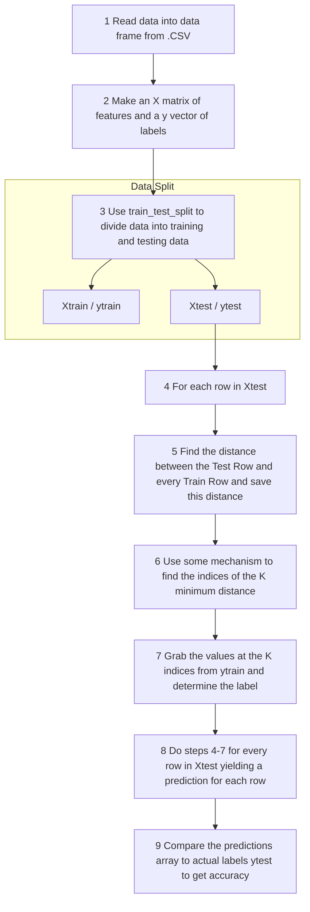

# KNN Illustrated

```python
import numpy as np
import pandas as pd
from sklearn.model_selection import train_test_split
```

## Workflow Diagram



---

For the KNN assignment we will use the following diagram as a guide --- JUST NUMPY PANDAS.

Remember all the imports before beginning. In this assignment we will use KNN to make predictions as to what type of iris a given flower is based on a set of features. This is analogous to the exercise we did in class categorizing graduate students and athletes based on calories burned per day and computer time per day. In that case our features would consist of calories burned per day and computer time per day and our labels were graduate student or student athlete. In this case we have a feature space of:
`SepalLengthCm`, `SepalWidthCm`, `PetalLengthCm`, `PetalWidthCm`

and our label space is:
`Iris-setosa`, `Iris-versicolor`, `Iris-virginica`

Peruse the diagram above so that you have an idea of how we will proceed for KNN.

## Summary of Tasks

- **Task 1)** Read data into the data frame from `.CSV`.
- **Task 2)** Make an `X` matrix of features and a `y` vector (1D array) of labels.
- **Task 3)** Use `train_test_split` to divide the data into training and testing data.
- **Task 4)** For each row in `Xtest`.
- **Task 5)** Find The distance between the Test Row and every Train Row and save this distance (i.e. create a vector with the same length as Xtest).
- **Task 6)** Use some mechanism to find the indices of the $K$ minimum distance.
- **Task 7)** Grab the values at the $K$ indices determined in Task 6 from `y train`.
- **Task 8)** Do step 4–7 for each row in `XTest` yielding a prediction for each row.
- **Task 9)** Compare the predictions array in Task 8 to the actual labels `yTest` and see how many were correct out of the total, this will be your accuracy.

---

## Detailed Task Descriptions

### Task 1) Read data into the data frame from .CSV
You can find the data here or in `sklearn`. Save it in a `.csv` and put it in the same folder as you python script. You can also change your current directory in the ipython console in spyder by going to the file folder icon at the top right and navigating to the folder where your python script resides. The command `read_csv` in pandas will read the csv into a data frame variable.

### Task 2) Make an X matrix of features and a y vector (1D array) of labels
By convention we typically call the matrix of features `X` and the vector of labels `y`. You can create your `X` matrix by making a new matrix consisting of just the feature columns of of the dataframe. You can do this any way you would like, I used drop a got rid of `"Species"` and `"ID"`. You can create your `y` vector by grabbing the `"species"` label from the data.

### Task 3) Use train_test_split to divide the data into training and testing data
The method `train_test_split` is part of `sklearn` package, it allows us to easily split the data into a training and testing set. By default it will randomly select 25% of the rows to be testing and 75% of the rows to be training (though that can be specified). It will return 4 things: `[Xtrain, Xtest, ytrain, ytest]`.

### Task 4) For each row in `Xtest`

### Task 5) Find The distance between the Test Row and every Train Row and save this distance (i.e. create a vector with the same length as Xtest)
We will do this by using the euclidean distance formula:

$$d(\mathbf{p}, \mathbf{q}) = d(\mathbf{q}, \mathbf{p}) = \sqrt{(q_1 - p_1)^2 + (q_2 - p_2)^2 + \cdots + (q_n - p_n)^2} = \sqrt{\sum_{i=1}^{n} (q_i - p_i)^2}$$

To make this explicit if my first row of `Xtest` is:
- `SepalLengthCm` 5.4
- `SepalWidthCm` 3.4
- `PetalLengthCm` 1.7
- `PetalWidthCm` 0.2

and my first row of `Xtrain` is:
- `SepalLengthCm` 6.4
- `SepalWidthCm` 3.2
- `PetalLengthCm` 4.5
- `PetalWidthCm` 1.5

The distance would be `3.25115` and would be saved in a vector of distances.

### Task 6) Use some mechanism to find the indices of the K minimum distance
I used `argpartition` with the value of $K$ (the number of neighbors we are using) but you can use any mechanism you want-- you do not want to lose the index information though because that will tell you the location in the labels training vector so you can make predictions.

### Task 7) Grab the values at the K indices determined in Task 6 from y train
You can use `np.unique` to get the unique labels and counts of each label. Using `argmax()` on the counts will give you the index into the unique labels that is the most. You can take that label and save it in an array or a list (whichever you want) of predictions. 

```python
[unique, counts] = np.unique(kPredictions, return_counts=True)
predictionsArray[p] = (unique[counts.argmax()])
```

### Task 8) Do step 4-7 for each row in XTest yielding a prediction for each row
By the end your should have 1 prediction for every row in `XTest`.

### Task 9) Compare the predictions array in Task 8 to the actual labels yTest and see how many were correct out of the total, this will be your accuracy
Compare the predictions array in Task 8 to the actual labels `yTest` (ie Using `==` b/w the predictionsArray + ytest will give you a `1` or a `0` if they are the same + different respectively, Using sum on this will give you the total correct predictions and dividing By the Size of yTest Should give You a `% correct`).